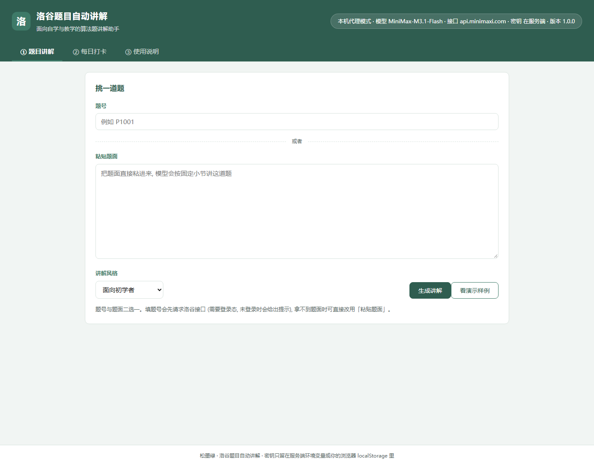

# luogu-explainer

> 洛谷题目自动讲解 —— 一个可交互的网页应用, 外加一个每天签到的小工具, 再加上第一阶段的学习笔记。
> 站点只做**讲解**; 打卡是命令行工具的活儿, 原因见 [为什么打卡不在网页上](#为什么打卡不在网页上)。



仓库最早的一句话描述是 "an auto-explainer of the algorithm problems, only for teaching and self studying"。
这句话仍然是准的 —— **题目讲解**是这个仓库的主线, **每日打卡**是顺手补上的第二件事,
**学习笔记**是把这一阶段的过程留档的第三件事。

## 怎么读这个仓库

三块东西, 各有各的入口, 互不干扰:

| 想看什么 | 去哪 | 需要什么 |
| --- | --- | --- |
| 讲解站点怎么用 | <https://gptsol56.github.io/luogu-explainer/> | 浏览器; 要真跑讲解则需要自己的模型密钥 |
| 打卡怎么跑 | `luogu_punch.py` + [每日打卡](#四打卡) | `LUOGU_CLIENT_ID` 与 `LUOGU_UID` 两个环境变量 |
| 这一阶段学了什么 | `notes/` 五章 | 什么都不需要, 直接在 GitHub 上读 |
| 笔记的原始依据 | `docs/draft/` 与 `docs/source-materials/` | 什么都不需要 |

## 在线站点

| 地址 | 说明 |
| --- | --- |
| <https://gptsol56.github.io/luogu-explainer/> | GitHub Pages 静态站, 三种运行形态自动识别 |

## 仓库里有什么

| 模块 | 位置 | 说明 |
| --- | --- | --- |
| 题目讲解 | `explainer/` | 取题 / 拼提示词 / 调模型。提示词模板是唯一真源 `explainer/prompt_template.json` |
| 网页应用 | `server/` `web/` | 本机代理层 (仅标准库) + 前端单页 (无构建步骤, 不引 CDN) |
| 每日打卡 | `luogu_punch.py` | 调洛谷 `/index/ajax_punch` 保住连续签到。凭据只走环境变量, 带 `--selftest` 离线自检 |
| 学习笔记 | `notes/` | 五章正文, 直接在 GitHub 上读, 不需要任何服务 |
| 笔记原稿 | `docs/draft/` | 笔记的 DOCX 原稿, 35 页 |
| 原始素材 | `docs/source-materials/` | 第一至第四天的原始笔记、任务书、终端记录、预览图 |
| 测试与门禁 | `tests/` `tools/` `.github/` | 单元测试、站点构建脚本、笔记同步校验、CI 与 Pages 工作流 |
| 部署 | `Dockerfile` `docker-compose.yml` | 让"部署一个 API 代理层"有现成路径 |

## 快速开始

### 0. 装依赖

```
pip install -r requirements.txt
```

只跑打卡与测试其实不需要装任何东西 —— `luogu_punch.py` 的 `requests` 是延迟导入的, `--selftest` 完全离线。

### 1. 先自检, 再干活

| 命令 | 断言数 | 联网 | 查什么 |
| --- | --- | --- | --- |
| `python luogu_punch.py --selftest` | 23 | 否 | 打卡逻辑: 201 的两种含义、缺凭据提示、时区换算 |
| `python -m unittest discover -s tests -v` | 23 | 否 | 打卡工具的单元测试 |
| `python explainer/luogu_explainer.py --selftest` | 25 | 否 | 提示词模板与代码常量同源、不留未替换占位符 |
| `python tools/build_site.py --selftest` | 6 | 否 | 静态产物组装: 文件齐全、模板可解析、无密钥字面量 |
| `python tools/check_notes_sync.py --selftest` | 5 | 否 | 笔记同步比对器: 能抓到正文/图片/文件名的任何差异 |

这几个命令**都不需要任何凭据**。没有它们, 工具一旦坏了你根本分不清是环境问题还是代码问题。

### 2. 配置凭据

所有凭据只从环境变量读, 仓库里只有空的 `.env.example` 模板:

| 变量 | 谁需要 | 怎么拿 |
| --- | --- | --- |
| `MINIMAX_API_KEY` | 题目讲解 | 模型后台的 API Key |
| `MINIMAX_BASE_URL` | 题目讲解 | 默认 `https://api.minimaxi.com/anthropic` |
| `MINIMAX_MODEL` | 题目讲解 | 默认 `MiniMax-M3.1-Flash` |
| `LUOGU_CLIENT_ID` | 打卡 / 自动取题 | 浏览器登录 luogu.com.cn → F12 → Application → Cookie → `__client_id` |
| `LUOGU_UID` | 打卡 / 自动取题 | 同一个面板里的 `_uid` |

Windows 上 `setx` 只对新开的进程生效。当前进程读不到时, 服务端会从注册表 `HKCU\Environment` 回退。

### 3. 本机跑完整形态

```
scripts\serve.cmd                    # 等价于 python server\app.py --port 8848
```

浏览器打开 <http://127.0.0.1:8848/>。此时是**本机代理模式**: 密钥只在服务端进程环境里,
浏览器不接触任何凭据; 填题号能自动抓洛谷题面, 打卡按钮也可用。

```
GET  /api/health             健康检查 (只暴露"有没有密钥", 绝不返回密钥本身)
GET  /api/problem/{pid}      抓洛谷题目
POST /api/explain            讲解 (body: {pid?, text?, style?})
POST /api/punch              服务端执行一次打卡
GET  /prompt_template.json   提示词模板 (与 explainer 读的是同一份文件)
```

### 4. 打卡

```
python luogu_punch.py                # 打一次
python luogu_punch.py --json         # JSON 输出, 方便脚本接管
python luogu_punch.py --schedule     # 常驻, 每天 10:00 (北京时间)
scripts\install_task.ps1             # 注册成 Windows 计划任务
```

退出码: `0` 成功 (含"今日已打卡") / `1` 打卡失败 / `2` 凭据或参数错误 / `130` 被 Ctrl+C 中断。

## 三种运行形态

站点部署在 GitHub Pages 上, Pages 没有后端, 所以同一份前端要能跑在两种环境里。页面启动时
探测 `/api/health`, 探测不到就切到自带密钥模式:

| 形态 | 密钥在哪 | 能不能自动取题 | 适用场景 |
| --- | --- | --- | --- |
| 本机代理模式 | 服务端进程环境变量 | 能 (需洛谷登录态) | 本机开发与自托管 |
| 自带密钥模式 (BYOK) | 你的浏览器 localStorage | 不能, 只能粘贴题面 | GitHub Pages 在线站 |
| 演示模式 | 不需要 | 不需要 | 只想看效果 |

BYOK 模式下密钥只写入本机浏览器的 localStorage, 不经过任何服务器, 也不进版本库。
想验证这一点可以直接看站点源码 —— 里面没有密钥, 只有你填进去的那一个。

### 为什么打卡不在网页上

两个实测原因, 都不是偷懒:

1. **洛谷的题目接口需要登录态。** 匿名 `GET /problem/P1001?_contentOnly=1` 返回的是 SPA 的 HTML 空壳,
   `POST /fe/api/problem/detail/P1001` 返回 403 `UserNotLoggedInException`。
2. **洛谷的响应没有 CORS 头。** 浏览器直连会被跨域策略拦掉, 所以打卡只能在有服务端的地方做。

因此打卡是命令行工具, 站点上的"每日打卡"页会直接告诉你怎么用命令行。

## 提示词只有一份

提示词模板放在 `explainer/prompt_template.json`。Python 后端与浏览器前端读的是**同一个文件** ——
后端 `load_prompt_template()` 读它, 前端 `fetch("prompt_template.json")` 读它。

这样做是为了避免一个很具体的问题: 两端各写一份提示词, 改了一边忘了另一边, 于是本机看到的讲解
和线上看到的讲解不一样, 而且很难查。CI 里有两条断言专门盯这件事:

- `build_prompt` 不留未替换的占位符;
- 模板里的 `required_sections` 与代码里的 `REQUIRED_SECTIONS` 必须是同一份定义。

## 学习笔记

第一阶段的学习笔记也在这个仓库里, 分三层: **正文**、**原稿**、**原始素材**。

### 笔记正文

| 文件 | 内容 |
| --- | --- |
| [notes/01-Git-学习记录.md](notes/01-Git-学习记录.md) | Git 概念、合并方式、团队协作与分支策略 |
| [notes/02-AI-Agent-学习记录.md](notes/02-AI-Agent-学习记录.md) | Agent 与 LLM 的区别、六块组成、Harness、实测基线、踩坑记录 |
| [notes/03-提交日记-洛谷打卡助手.md](notes/03-提交日记-洛谷打卡助手.md) | 一次真实的 Git 提交: 取证 → 写 → 提交 → 验证 |
| [notes/04-把仓库做成一个完整的整体.md](notes/04-把仓库做成一个完整的整体.md) | 三个模块各归其位、两种部署形态、版本控制实操 |
| [notes/05-拆仓库-公开的站点与私有的笔记.md](notes/05-拆仓库-公开的站点与私有的笔记.md) | 为什么拆仓库、BYOK 与提示词单一真源、清理迁移、验证证据 |

正文是**纯章节内容**: 不带 YAML frontmatter, 不带"本文件来自 DOCX…"这类说明行。
它们由 `docs/draft/` 里的 DOCX 原稿转换而来, 不是手抄的。

### 笔记原稿与素材

| 位置 | 是什么 |
| --- | --- |
| `docs/draft/` | 《淳阳项目组学习笔记_第一阶段_GIT_AND_AGENT.docx》, 35 页 / 段落 366 / 表格 17 / 内嵌图 3 |
| `docs/source-materials/` | 第一至第四天的原始笔记、前置学习任务与计划、终端记录、版面预览图、技能盘点记录 |

原始素材保留的理由很实在: 阶段任务书要交"过程", 原始稿和成稿放在一起, 以后回头看才知道
哪些判断是后来改的。

### 重新生成正文

正文是转换产物, 所以要改就改 DOCX, 再重新转:

```
python tools/docx_to_md.py \
  --input "docs/draft/淳阳项目组学习笔记_第一阶段_GIT_AND_AGENT.docx" \
  --out-dir notes --split --no-copy-docx
```

转换器自带零丢失核对: 段落 343/343、表格行 119/119、内嵌图 3 张, 缺失 0。
封面标题 (DOCX 的 h1 主标题) 有意不进章节正文 —— 它在本文件与 DOCX 封面里, 核对时会显式报出来。

### 正文与原稿不会漂

CI 里有一个作业专门盯这件事:

```
python tools/check_notes_sync.py     # 重新转一遍, 与仓库里的 notes/ 逐字节比对
```

只要有一处不一致 (哪怕只是少一个换行), 作业就红。Markdown 不会报错, 漂了从肉眼看不出来,
GitHub 上照常渲染 —— 所以必须让机器每次都比一遍。

## 关于学号与姓名

笔记的 **DOCX 原稿封面**上写着作者的姓名与学号（正文瘦身成五章后, 具体值不再出现在正文里）。
按作者要求**原样保留**, 没有打码。

笔记第四章里写着"笔记含姓名与学号, 所以只能在私有仓库里" —— 那是当时拆仓库时的判断,
按"不改学习过程"的原则保留了原文。实际情况以本文件为准: 笔记现在就在这个公开仓库里。

如果哪天要收回, 删掉 `docs/draft/` 即可 —— 五章正文里不含具体学号姓名, 站点与打卡工具、
转换与校验脚本都不受影响。

## 还没做的, 以及为什么

写清楚比含糊过去好, 这三条也是笔记第四章里记的:

1. **真实打卡还没跑通。** 洛谷登录态只在本机浏览器里, 从没取出到环境变量, 所以至今没有一次真实的 `code=200` 输出。当前状态是"工具已就绪、打卡待凭据"。
2. **填题号抓题面需要登录态。** 没有 Cookie 的用户只能粘贴题面; 公开站点上更是只能粘贴 —— 洛谷没有 CORS 头。
3. **演示样例是预生成的。** 它是真的调过一次模型后存下来的, 但存下来之后模型再更新, 样例就会过时。所以界面里明确标了"这是预先生成的样例, 不是实时调用"。

## 部署

### GitHub Pages

`.github/workflows/pages.yml` 会在 push 到 `main` 时自动组装并发布:

```
python tools/build_site.py --out _site     # web/ + prompt_template.json -> _site/
```

组装脚本自带校验: 必需文件必须齐全、模板必须可解析、**产物里不许出现任何密钥字面量**。
CI 跑的是同一个脚本, 所以"测的"和"发的"是同一份东西。

### Docker

```
docker compose up -d
```

先按 `.env.example` 建一个 `.env` 填好密钥。容器里 `LUOGUBOT_HOST=0.0.0.0`, 端口 `8848`。

## 目录结构

```
luogu-explainer/
├── luogu_punch.py          每日打卡 (单文件, 自带 --selftest)
├── explainer/              讲解核心: 取题 / 提示词模板 / 调模型
│   └── prompt_template.json 提示词唯一真源 (后端与前端共用)
├── server/app.py           API 代理层 + 静态站点 (仅标准库)
├── web/                    前端单页 (无构建步骤, 不引 CDN)
│   └── sample-explanation.json 真实调用生成的演示样例
├── notes/                  学习笔记正文 (五章) + 内嵌图
├── docs/
│   ├── draft/              笔记 DOCX 原稿
│   ├── source-materials/   第一至第四天的原始素材
│   └── images/             界面截图
├── tests/                  打卡工具的单元测试
├── tools/                  站点构建、笔记转换与 CI 校验脚本
├── scripts/                计划任务安装 / 手动触发 / 启服务
├── .github/workflows/      CI 门禁与 Pages 部署
├── CONTRIBUTING.md         分支模型 / 提交规范 / 版本控制硬规矩
└── requirements.txt
```

## 这个仓库怎么长成现在这样

一开始是三个仓库: 公开的站点与代码、私有的笔记正文、私有的笔记原稿与素材。
最后合成一个, 原因写在笔记第五章 —— 判断依据不是内容敏感度, 而是**访问方式**:
谁能 clone、谁能访问 URL、要不要服务端。

合并之后的几条硬规矩, 都在 [CONTRIBUTING.md](CONTRIBUTING.md) 里:

- 凭据永远不进版本库 (只有空的 `.env.example`);
- 不提交大文件、虚拟环境、缓存、第三方源码树;
- 历史不改写: 不 rebase 已推送的共享分支, 不 force-push;
- 一次提交只做一件事, 推完必须回读远端 tree 的 blob SHA 跟本地逐个对上。

## 版本控制

一句话总结这一阶段学到的: **Git 是内容寻址的, 所以哈希一致才是最强的证据** ——
推送后要把远端 tree 的每个 blob SHA 跟本地 `git ls-tree` 逐个对上, 光看命令没报错不算数。

## 许可

见 [LICENSE](LICENSE)。引用的第三方项目:

- 洛谷打卡接口行为参考 <https://github.com/kierankihn/auto-checkin>
- 技能清单来自 <https://github.com/affaan-m/ECC>
