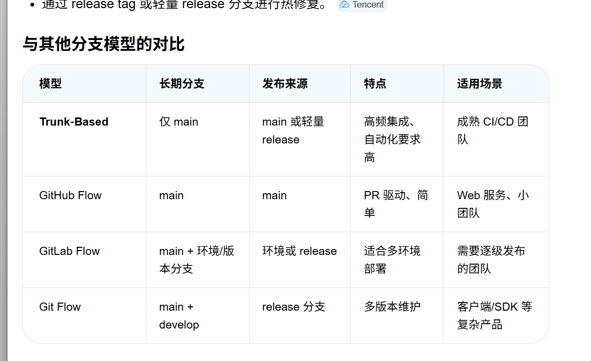
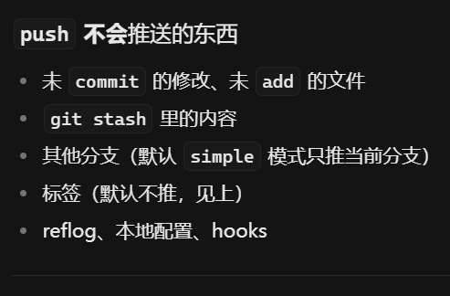
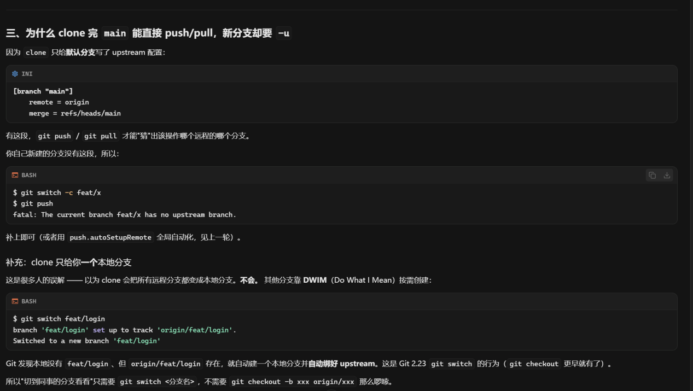

# 一、Git 版本控制与团队协作

git作为当前版本控制工具的典范，采用分布式结构。核心是记录文件快照，运用内容寻址存储，天然去重；无法篡改哈希值保证完整性，操作广泛，可以log/diff/开分支（成本极低），大仓库操作方便，合并能力好，github联动。

版本控制五件事：可追溯、可回滚、可并行、可合并、可审计。本质上，复制备份只保存了状态，版本控制保存了状态 + 变更原因 + 变更者 + 变更之间的关系。说清楚改什么，为什么改，改的不好怎么调整，回滚还是在此基础上建设，如何合并二人代码，冲突怎么办。

Git 是工具，GitHub/Gitee 是托管平台。托管平台需要网络，git工具不需要，可完全离线。，gitee国内方便访问，同一个本地仓库可以同时配置多个 remote（origin 指 GitHub，gitee 指 Gitee），代码不绑定平台。企业内常用自建 GitLab 或 Gitea，因为代码不能出内网。

仓库（Repository）：.git 目录（对象库 + 引用 + 配置）+ 工作区。本地仓库和远程仓库是平等的，只是角色不同。提交（Commit）：一次完整快照 + 元数据（作者、时间、提交信息、父提交指针）。它有唯一哈希，是历史的节点。分支（Branch）：指向某个 commit 的可移动指针，如 refs/heads/main。HEAD 指向当前所在分支。提交时指针自动前移。

## 1.1 合并的三种方式

Fast-forward：目标分支没有分叉，指针直接前移，不产生新提交。

三方合并（Three-way merge）：以共同祖先为基准，对比双方改动，生成 merge commit。双方改了同一区域时产生冲突，需人工解决后 git add + git commit。

rebase 是另一种整合方式，把提交“搬到”新基点上，历史线性但会重写哈希，不要对已推送的共享分支 rebase。

### 原历史：

```
  A ← B ← C ← D   (main)
          ↑
          E ← F   (feat)
```

### git rebase main 之后（在 feat 上）：

```
  A ← B ← C ← D ← E' ← F'   (feat)
                  ↑
              新哈希，内容相同但父提交变了
```

小团队用 GitHub Flow（main + 短生命周期 feature 分支），大型发布制用 Git Flow，追求持续交付用 Trunk-Based（短分支 + 频繁合入）



```
Git clone <repo>
Git switch -c feat/login-timeout
#文件创建/编辑，代码生成 打包
Git add -p
git commit -m "feat: ..."
git fetch origin 同步
git rebase origin/main  变基
# 发起 PR → Code Review → CI 通过 → Squash 合并 → 删分支
git tag -a v1.2.0 -m "..." 
```

注意git pull 默认产生无意义 merge commit（建议配 pull.rebase=true）；误提交密钥后光删文件没用，历史里还在，必须轮换密钥并清理历史（filter-repo）。

```
git push <remote> <本地ref>:<远程ref>
```

| 写法 | 含义 |
| --- | --- |
| git push | 推当前分支到它的 upstream（最简单，日常用这个） |
| git push origin main | 本地 main → 远程 main |
| git push origin HEAD | 本地当前分支 → 远程同名分支 |
| git push origin HEAD:main | 本地当前分支 → 远程 main |
| git push origin main:feat | 本地 main → 远程 feat（改名推） |
| git push origin :feat | 删除远程 feat（左边空 = 推空） |
| git push origin --delete feat | 同上，可读性更好 |
| git push -n origin main | 试运行（--dry-run），只打印不执行 |
| git push --all | 推所有本地分支 |
| git push --tags | 推所有标签 |

顺序：先 fetch，再整合，最后 push。



```
git push --force-with-lease 松散强推 不一样的可以不推
git fetch
git log --oneline feat..origin/feat    # 必须为空！非空说明别人推了新提交
```



clone = init + remote add + fetch + switch --track + checkout。

Git reset/revert:--soft/--hard/--mixed 路径（等价于restore staged）/keep指针 + 暂存区，工作区尽量保留 git reset --hard origin/main 本地完全对齐远程	/git reset --hard ORIG_HEAD撤销危险操作 /merge退出合并、

```
# 务必在全新 clone 上做，别在自己正在开发的工作副本里
git clone --no-local /path/to/repo clean-repo && cd clean-repo
filter -repo
git filter-repo --invert-paths --path .env --path config/secrets.yml   # 删掉这些文件的所有历史
git filter-repo --replace-text passwords.txt                          # 把历史里的字符串替换成 ***REMOVED***
git filter-repo --strip-blobs-bigger-than 50M                         # 删掉超大 blob
git remote add origin <url>
git push --force --all && git push --force --tags
Amend  git commit -m "feat: 加登录"
git add forgot.js
        git commit --amend --no-edit          # 把漏掉的文件塞进上一条，消息不变
git commit --amend -m "feat(login): 新增登录表单"   # 只改消息
```

| 维度 | cherry-pick | stash | rebase --onto |
| --- | --- | --- | --- |
| 搬什么 | 一条已提交的改动 | 未提交的改动 | 一段提交范围 |
| 搬完原物 | 保留在原分支 | 从工作区移除 | 原分支指针不动（除非 HEAD） |
| 是否进历史 | 立刻进 | 不进（隐藏提交） | 进（重写后） |
| 改哈希 | 会（新提交） | 不涉及历史 | 会（全部重写） |
| 冲突概率 | 中（依赖前序提交时高） | 中（基底变了就冲突） | 高 |
| 撤销 | --abort | drop 后 fsck 救 | ORIG_HEAD / reflog |
| 典型场景 | backport hotfix | 临时切分支 | 摘掉一串中间提交 |

Git pull =git fetch+git merge 有时候先用rebase

## 1.2 完整一轮项目开发流程

1.仓库初始化+主分支保护 防止强制改动
(1.gitignore

2..gitattributes          # 换行符、大文件

3.README.md

4.CONTRIBUTING.md         # 分支规范、提交规范、PR 流程

5..github/PULL_REQUEST_TEMPLATE.md

6..github/workflows/ci.yml

7..editorconfig

8.pre-commit 配置（lint/format）

)

### 1.2.1 分支策略：Git Flow

配置身份+统一配置+安装hookhusky / pre-commit

```
git remote -v
# origin  git@github.com:org/repo.git
```

### 1.2.2 日常开发

## 1.3 团队协作与分支策略

### 1.3.1 日常开发五步走

```
# 开工
git switch main && git pull --rebase && git switch -c feat/xxx
# 编码
git add -p && git commit -m "feat: ..."
# 同步
git fetch origin && git rebase origin/main
# 推送
git push -u origin feat/xxx
# 合并后
git switch main && git pull --rebase && git branch -d feat/xxx
```

### 1.3.2 提交 PR/MR 与解决冲突

### 1.3.3 CI/CD 流水线

提交 → lint静态代码检查潜在 bug、风格、规范

lint 是不运行代码的自动代码审查，把低级错误和规范问题挡在提交/合并之前；它和 format（排版）、typecheck（类型）、test（行为）是四件不同的事，流水线里通常在 build 之前、PR 门禁中执行。/format → 单测 → 构建 → 镜像 → 部署 dev

### → 集成测试 → 部署 staging → 人工/自动 → 部署 prod

8.E2e端到端测试是一种软件测试方法，用于验证整个应用程序的流程是否从用户的角度按预期工作。它模拟真实的用户场景，从用户界面 (UI) 开始，通过应用程序的各个层面（包括与其他系统、数据库、网络等的交互），直到最终输出或结果。

端到端（E2E）测试学习笔记什么是端到端测试 (E2E Testing)？ 端到端测试是一种软件测试方法，用于验证整个应 - 掘金 e2e了解了一下 playright目前个人觉得在最佳，可泛用性原因

### 1.3.4 发布与 Hotfix

### 1.3.5 代码提交与流水线检查

```
  ↓
lint / format / typecheck        ← 静态检查
  ↓
unit test                        ← 单元测试（纯函数/类）
  ↓
build                            ← 产出镜像/前端包
 ↓
integration test                 ← 集成测试（DB、消息队列、模块间）
  ↓
部署 dev / preview 环境
  ↓
E2E test                         ← 端到端（浏览器/API 全链路）
  ↓
部署 staging → 发布前 E2E 门禁
 ↓
部署 prod → 生产 smoke E2E 
```
